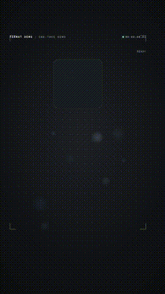

# One-Take Showreel

**Turn one idea into a continuous 15-second brand animation.**



[Watch the 15-second MP4](examples/form-demo.mp4). Fictional brand, silent demo.

A working local motion engine and agent skill: a card folds into a token, splits into formats, recombines and lands in a logo lockup. Includes a fictional FORM demo; your agent adapts its objects, motion and copy to your actual brand.

```sh
npm ci
node scripts/create.mjs demo-film --brand FORM --format 15x9:16
cd demo-film
npm run check
npm run render -- --output renders/review.mp4
```

Node 22+, npm, and the HyperFrames renderer/browser prerequisites are required. HyperFrames is fetched on first use; use its CLI diagnostics if rendering dependencies are missing. No paid generation API or account is required by this scaffolder. The example is deliberately silent, so no music library or credentials are needed.

Formats: 6, 15 or 30 seconds × 16:9 or 9:16. Short versions omit the middle stages; vertical versions reblock the layout. A custom brand requires actual design and visual review. This is not a one-click guarantee of professional output or follower growth.

Reproduction prompt:
> Read SKILL.md. Scaffold the FORM demo at 15 seconds vertical, render it, inspect the final output, then show me the review video and editable files. Keep it silent and clearly marked as a demonstration brand.

Run `npm test` for scaffolding/refusal tests. See `examples/` for the rendered demo and verification notes once generated.

## Install as a skill

Clone this repository into your agent's skills directory under the repository name, or ask your agent to read the root `SKILL.md` directly. This is an agent instruction package plus local scripts, not a hosted service. Review scripts before running them. Do not copy credentials or private footage into a public fork.

No metered model API is required by these scripts. Your coding agent and optional rendering tools have their own requirements. Tested locally on macOS; Windows/Linux have not yet been verified.

## Companion resource

[Download the three-skill field guide](docs/field-guide.pdf) · [Copy the reproduction prompts](docs/copyable-prompts.txt)
